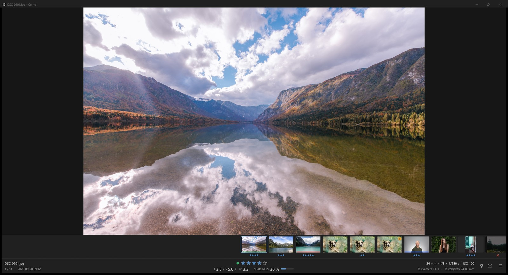

# Cerno

**Fast photo viewer and culling tool – switch instantly, rate from the keyboard, keep the file dates.**

Cerno (Latin *cerno* – "I sift, see clearly") helps you go through a folder of photos quickly and keep the good ones. Stars, colour labels, comments and keywords go straight into the file, where Lightroom, Bridge, digiKam and Windows Explorer find them – the file's dates stay exactly as they were. Everything runs on your computer.

  

Sample photo: CC0 (public domain), [Images from Unsplash](https://commons.wikimedia.org/wiki/Category:Images_from_Unsplash) on Wikimedia Commons.

## What it does

- **Instant switching** – the photos around the current one are loaded in advance.
- **Rate from the keyboard** – stars, reject, colour labels, comment and keywords; `Ctrl+Z` takes marks back, newest first.
- **Two helpers under every photo** – *Aesthetics* (two local AI models, downloaded once when you ask) and *Sharpness*, both in percent; empty stars fill lightly with Cerno's guess of your rating.
- **Sort and filter** – by capture time, rating, aesthetics, sharpness, camera or keyword; blurry shots, duplicates, similar photos, photos with or without people, a client's list of file names – and *Top 10 … Top 250*, the best photos for a slideshow or a photo book.
- **Compare** two or four photos side by side, thin out a burst pair by pair, or see the folder as a grid or grouped into scenes.
- **RAW + JPG as one photo**, and **straighten, crop and rotate** JPEGs – the original is kept and `Ctrl+Z` brings it back.
- **Nothing is lost** – deleting moves a photo into a hidden `.originals` folder beside it (empty it yourself – it is not the Recycle Bin); `Ctrl+Z` puts it back.
- **Formats** – JPEG, HEIC, PNG, TIFF, WebP, BMP, GIF, RAW (its embedded preview) and videos (MP4, MOV, MKV, WebM, AVI, MTS …), which play right here with sound; **five languages** – German, English, French, Spanish, Italian.

## Install

Download from [Releases](https://github.com/fly2nbc-oss/Cerno/releases):

| File | For |
|---|---|
| `cerno_<version>_x64-setup.exe` | Windows 10/11 – installs for your user, no admin rights |
| `cerno_<version>_x64-portable.zip` | Windows – unzip anywhere and run `Cerno\cerno.exe` |
| `cerno_<version>_x86_64.AppImage` | Linux with glibc 2.39 or newer – tested on Ubuntu 24.04, Debian 13, Fedora 44 and Arch Linux |
| `cerno_<version>_amd64.deb` | Ubuntu 24.04+ / Debian 13+ – `sudo apt install ./cerno_<version>_amd64.deb` |

The Windows files are not signed yet: SmartScreen asks once (*More info* → *Run anyway*). The AppImage can be brought up to date with [AppImageUpdate](https://github.com/AppImageCommunity/AppImageUpdate), which fetches only what changed (the release's `.zsync` file); Cerno itself downloads no updates.

**Writing stars and labels** needs [ExifTool](https://exiftool.org/): on Windows Cerno offers to download it (11 MB) the first time it is needed; on Linux install it with the package manager (`apt install libimage-exiftool-perl`). Viewing works without it.
**Videos** play with GStreamer: the Windows downloads bring it along; on Linux the `.deb` installs it, and the AppImage uses the system's (on Fedora, H.264 videos need `openh264` from the `fedora-cisco-openh264` repository).

## The most important keys

| Key | Does |
|---|---|
| `→` / `←`, `Space` | Next / previous photo (`Space` on a video: play / pause) |
| `1`–`5`, `0`, `X`, `6`–`9` | Stars, no stars, reject, colour label (`Shift` + key: and go on) |
| `Delete` | Delete – `Esc` within 5 s brings it back |
| `Z`, `C`, `Alt+C` | 100 % zoom, compare, whole photo and 100 % side by side |
| `F2` / `F3` / `F4` / `F5` | Photo / grid / scenes / faces |
| `F10` or `Alt+1` / `Tab` or `Alt+2` / `T` or `Alt+3` / `F6` or `Alt+4` | Menu bar / details / filter bar / filmstrip |
| `Ctrl+Z` | Undo the last mark or edit – on a deleted photo: put it back |
| `H` | Help: every key, and tips on working with Cerno |

## Privacy

Cerno works on your computer. Your photos, their names and your ratings never leave it, and there is no telemetry. This program will not transfer any information to other networked systems unless specifically requested by the user or the person installing or operating it:

- **Update check, only if you agree** at the first start: then once a day one request to `github.com/fly2nbc-oss/Cerno/releases/latest`, which says only that it comes from "Cerno" (GitHub sees your IP address, as with any website). A newer version is only named, nothing is downloaded. *Settings ▸ Check for updates* turns it off.
- **Downloads you ask for:** the aesthetics models (Hugging Face, this repository's releases) and, on Windows, ExifTool (SourceForge) – each checked by size and SHA-256.
- **Links you click:** GitHub issues from *About Cerno*, a photo's GPS position in Google Maps or OpenStreetMap.

## Code signing policy

Free code signing provided by [SignPath.io](https://about.signpath.io/), certificate by [SignPath Foundation](https://signpath.org/) – for the Windows releases from the one in which the SignPath Foundation has accepted the project; earlier ones are unsigned.

- **What is signed:** only what this repository builds – `cerno.exe` and the installer `cerno_<version>_x64-setup.exe`, in the CI run of the release's tag, from the source at that tag. The libraries of others in the package (GStreamer, libheif, ONNX Runtime, the VC++ runtime) keep their own signatures or have none, and the uninstaller, which the installer writes on your computer, is not signed.
- **Committers and reviewers:** [fly2nbc-oss](https://github.com/fly2nbc-oss), the author.
- **Approvers:** fly2nbc-oss – every signing request is approved by hand.
- **Privacy:** see [Privacy](#privacy). Cerno sends nothing but the update check, which runs only once you have agreed to it at the first start and can be turned off again.

## More

- Building from source and checks: [`CONTRIBUTING.md`](./CONTRIBUTING.md)
- Changes per version: [`CHANGELOG.md`](./CHANGELOG.md)
- Reporting a vulnerability, network and file access in detail: [`SECURITY.md`](./SECURITY.md)
- License: Apache 2.0 ([`LICENSE`](./LICENSE)), third-party components in [`THIRD_PARTY.md`](./THIRD_PARTY.md)
